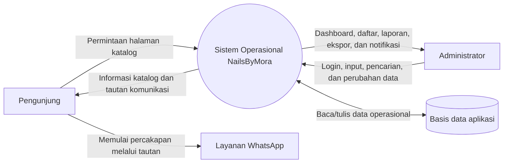
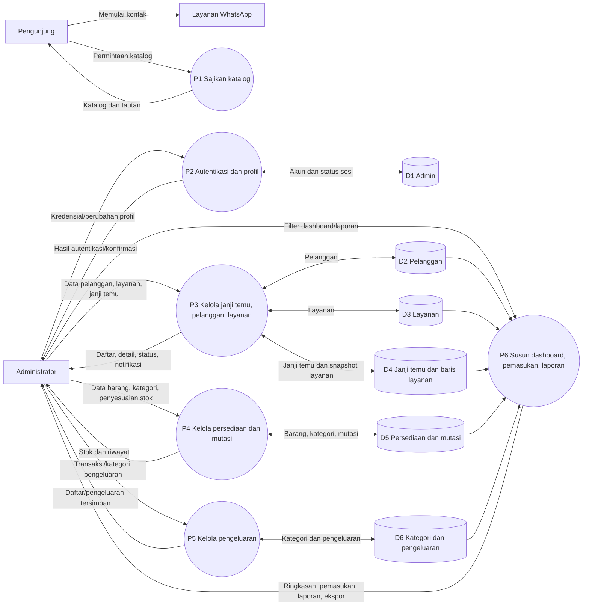
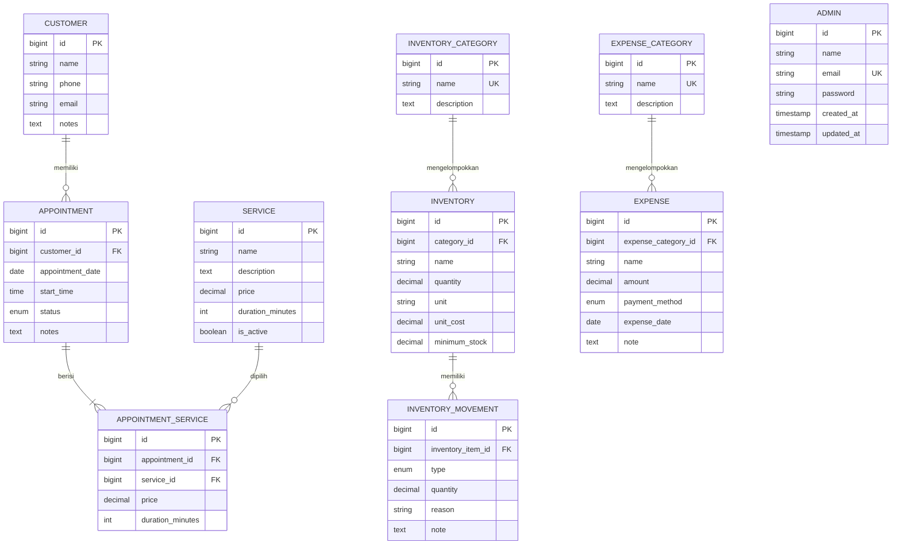

# Spesifikasi Kebutuhan Perangkat Lunak
## Sistem Operasional NailsByMora

**Status:** Draft untuk ditinjau  
**Tanggal penyusunan:** 6 November 2026  
**Kode dokumen:** `[PERLU KONFIRMASI]`  
**Revisi:** 0.1  
**Pelanggan/pemilik usaha:** `[PERLU KONFIRMASI]`  
**Pengembang/tim:** `[PERLU KONFIRMASI]`  
**Institusi/program studi:** `[PERLU KONFIRMASI]`

> Dokumen ini disusun dari struktur aplikasi dan sumber yang tersedia di repositori. Fakta implementasi dipisahkan dari asumsi dan keputusan yang masih harus disetujui. Penanda `[PERLU KONFIRMASI]` menunjukkan informasi yang belum didukung bukti atau belum ditetapkan pemilik sistem. Dokumen belum berstatus persetujuan final.

## Identitas Dokumen

| Atribut | Nilai |
|---|---|
| Nama dokumen | Spesifikasi Kebutuhan Perangkat Lunak Sistem Operasional NailsByMora |
| Nomor dokumen | `[PERLU KONFIRMASI]` |
| Revisi | 0.1 |
| Tanggal | 6 November 2026 |
| Status | Draft untuk ditinjau |
| Pemilik dokumen | `[PERLU KONFIRMASI]` |
| Pemeriksa/persetuju | `[PERLU KONFIRMASI]` |

## Riwayat Perubahan

| Revisi | Tanggal | Deskripsi | Penulis | Pemeriksa/persetuju |
|---|---|---|---|---|
| 0.1 | 6 November 2026 | Penyusunan draft SKPL berdasarkan outline dan implementasi yang tersedia | `[PERLU KONFIRMASI]` | `[PERLU KONFIRMASI]` |

## Halaman Perubahan

| Revisi | Bagian/halaman yang berubah | Deskripsi |
|---|---|---|
| 0.1 | Seluruh dokumen | Dokumen awal; nomor halaman mengikuti hasil ekspor/cetak |

## Daftar Isi

- [BAB I — Pendahuluan](#bab-i--pendahuluan)
  - [1.1 Tujuan Penulisan Dokumen](#11-tujuan-penulisan-dokumen)
  - [1.2 Lingkup Masalah](#12-lingkup-masalah)
  - [1.3 Definisi, Akronim, dan Singkatan](#13-definisi-akronim-dan-singkatan)
  - [1.4 Referensi](#14-referensi)
  - [1.5 Deskripsi Umum Dokumen](#15-deskripsi-umum-dokumen)
- [BAB II — Deskripsi Global Perangkat Lunak](#bab-ii--deskripsi-global-perangkat-lunak)
  - [2.1 Perspektif Produk](#21-perspektif-produk)
  - [2.2 Fungsi Produk](#22-fungsi-produk)
  - [2.3 Karakteristik Pengguna](#23-karakteristik-pengguna)
  - [2.4 Batasan-batasan](#24-batasan-batasan)
  - [2.5 Asumsi dan Kebergantungan](#25-asumsi-dan-kebergantungan)
- [BAB III — Deskripsi Rinci Kebutuhan](#bab-iii--deskripsi-rinci-kebutuhan)
  - [3.1 Kebutuhan Antarmuka Eksternal](#31-kebutuhan-antarmuka-eksternal)
  - [3.2 Kebutuhan Fungsional](#32-kebutuhan-fungsional)
  - [3.3 Pemodelan Data](#33-pemodelan-data)
  - [3.4 Kebutuhan Non-Fungsional](#34-deskripsi-kebutuhan-non-fungsional)
  - [3.5 Atribut Kualitas Perangkat Lunak](#35-atribut-kualitas-perangkat-lunak)
  - [3.6 Batasan Perancangan](#36-batasan-perancangan)
  - [3.7 Matriks Keterunutan](#37-matriks-keterunutan-traceability-matrix)
- [Validasi dan Hal yang Perlu Dikonfirmasi](#validasi-dan-hal-yang-perlu-dikonfirmasi)
- [Daftar Gambar](#daftar-gambar)
- [Daftar Tabel](#daftar-tabel)

## Daftar Gambar

1. Gambar 1. Diagram konteks Sistem Operasional NailsByMora.
2. Gambar 2. DFD Level 1 Sistem Operasional NailsByMora.
3. Gambar 3. ERD konseptual Sistem Operasional NailsByMora.

## Daftar Tabel

1. Tabel 1. Definisi, akronim, dan singkatan.
2. Tabel 2. Istilah bisnis dan operasional.
3. Tabel 3. Fungsi produk.
4. Tabel 4. Karakteristik pengguna.
5. Tabel 5. Batasan sistem.
6. Tabel 6. Asumsi operasional.
7. Tabel 7. Kebergantungan sistem.
8. Tabel 8. Halaman dan antarmuka utama.
9. Tabel 9. Kebutuhan perangkat lunak/integrasi.
10. Tabel 10. Kebutuhan fungsional.
11. Tabel 11. Deskripsi proses.
12. Tabel 12. Kamus data ringkas.
13. Tabel 13. Entitas dan atribut utama.
14. Tabel 14. Pemetaan entitas ke tabel fisik.
15. Tabel 15. Kebutuhan performansi.
16. Tabel 16. Atribut sistem perangkat lunak.
17. Tabel 17. Kebutuhan antarmuka dan operasional.
18. Tabel 18. Matriks keterunutan.
19. Tabel 19. Hal yang perlu dikonfirmasi.

# BAB I — Pendahuluan

## 1.1 Tujuan Penulisan Dokumen

Dokumen Spesifikasi Kebutuhan Perangkat Lunak (SKPL) ini menetapkan gambaran kebutuhan, fungsi, data, batasan, dan atribut kualitas Sistem Operasional NailsByMora. Dokumen menjadi dasar bersama bagi pemilik usaha, pengguna operasional, pengembang, dan penguji untuk memvalidasi ruang lingkup serta memeriksa bahwa implementasi sesuai kebutuhan.

SKPL digunakan sebagai acuan dalam analisis, desain, implementasi, dan pengujian. Setiap kebutuhan fungsional diberi ID agar dapat dilacak ke proses dan data yang terkait.

Target pembaca:

- Pemilik atau wakil usaha NailsByMora.
- Administrator/pengelola salon.
- Analis dan pengembang perangkat lunak.
- Penguji dan pihak yang melakukan penerimaan sistem.

## 1.2 Lingkup Masalah

### Gambaran perangkat lunak

Nama proyek yang tampak pada antarmuka dan konfigurasi adalah **NailsByMora**. Sistem berbasis web ini menggabungkan katalog publik dan alat operasional internal untuk usaha nail studio. Katalog publik menyediakan pengenalan layanan serta tautan untuk memulai komunikasi pemesanan melalui WhatsApp. Area administrasi yang memerlukan autentikasi menyediakan pengelolaan janji temu, pelanggan, layanan, persediaan, pengeluaran, pemasukan, laporan, ringkasan dashboard, serta profil administrator.

### Latar belakang dan masalah

Kode yang tersedia memperlihatkan kebutuhan operasional yang ditangani sistem: pencatatan jadwal dan status janji temu, data pelanggan dan layanan, mutasi persediaan, pengeluaran, serta ringkasan pendapatan dan laporan. Alasan bisnis, proses manual saat ini, tingkat kesulitan yang dialami, serta target manfaat belum didokumentasikan melalui wawancara atau observasi; karena itu semua rincian tersebut **[PERLU KONFIRMASI]** dan tidak dianggap sebagai pernyataan pelanggan.

### Tujuan sistem

1. Menyediakan informasi layanan kepada calon pelanggan melalui katalog publik.
2. Mendukung administrator mencatat dan memantau janji temu serta data pelanggan/layanan.
3. Mendukung pencatatan persediaan dan mutasinya.
4. Mendukung pencatatan pengeluaran dan penyajian pemasukan yang dihitung dari layanan pada janji temu selesai.
5. Menyediakan ringkasan dashboard dan laporan yang dapat dicetak atau diekspor.

Tujuan di atas menggambarkan fungsi yang telah ditemukan dalam implementasi. Prioritas dan kriteria keberhasilan bisnisnya masih perlu disepakati.

### Ruang lingkup

**Termasuk dalam cakupan:**

- Halaman katalog publik dan tautan komunikasi/pemesanan eksternal.
- Login dan logout administrator, pengubahan identitas profil, dan pengubahan kata sandi.
- Dashboard ringkasan operasional dan keuangan.
- Pencatatan, penelusuran, perubahan, perubahan status, dan penghapusan janji temu.
- Pengelolaan data pelanggan dan layanan, termasuk kategori pencarian/lookup terkait janji temu.
- Pengelolaan barang persediaan, kategori, penyesuaian stok, dan riwayat mutasi.
- Pengelolaan pengeluaran dan kategori pengeluaran.
- Tampilan pemasukan yang bersumber dari baris layanan pada janji temu berstatus selesai.
- Laporan keuangan, pemasukan, pengeluaran, janji temu, kinerja layanan, pelanggan, status persediaan, dan mutasi stok; cetak dan ekspor CSV/XLSX.

**Di luar cakupan atau belum terbukti:**

- Pembayaran daring, pemrosesan kartu, rekonsiliasi bank, dan faktur pajak.
- Pemesanan janji temu yang tersimpan langsung dari halaman publik; tautan publik yang ditemukan membuka WhatsApp.
- Pengiriman pengingat otomatis melalui WhatsApp, SMS, atau surel.
- Integrasi payment gateway, sistem akuntansi, kalender eksternal, atau aplikasi pihak ketiga selain tautan WhatsApp.
- Multi-cabang, multi-peran administrator, penggajian, dan jadwal/kapasitas tenaga kerja.
- Pemakaian barang persediaan otomatis berdasarkan layanan yang dikerjakan.
- Pengelolaan foto/berkas pelanggan atau riwayat desain kuku.

Item di luar cakupan tersebut tidak dimaknai sebagai penolakan kebutuhan; konfirmasi perlu dilakukan apabila dibutuhkan pelanggan.

## 1.3 Definisi, Akronim, dan Singkatan

**Tabel 1. Definisi, akronim, dan singkatan**

| Kata kunci/frasa | Definisi |
|---|---|
| SKPL | Spesifikasi Kebutuhan Perangkat Lunak. |
| SRS | *Software Requirements Specification*; istilah bahasa Inggris untuk dokumen spesifikasi kebutuhan perangkat lunak. |
| API | *Application Programming Interface*; antarmuka pertukaran data antarperangkat lunak. |
| DBMS | *Database Management System*; perangkat lunak pengelola basis data. |
| DFD | *Data Flow Diagram*; diagram proses dan aliran data. |
| ERD | *Entity Relationship Diagram*; diagram entitas dan relasi data. |
| PDM | *Physical Data Model*; representasi struktur data pada DBMS. |
| Inertia | Adapter yang menghubungkan respons Laravel dengan halaman Vue tanpa pola API terpisah untuk navigasi halaman. |
| Mutasi stok | Pencatatan penambahan (`IN`) atau pengurangan (`OUT`) kuantitas barang persediaan. |
| Janji temu | Catatan kunjungan dengan pelanggan, tanggal, waktu mulai, status, catatan, dan satu atau lebih layanan. |
| Baris layanan janji temu | Relasi janji temu dan layanan yang menyimpan harga serta durasi layanan sebagai snapshot. |

**Tabel 2. Istilah bisnis dan operasional**

| Istilah | Definisi dalam dokumen |
|---|---|
| Pemilik usaha | Pihak yang menetapkan kebijakan dan menyetujui kebutuhan; identitasnya `[PERLU KONFIRMASI]`. |
| Administrator | Pengguna internal yang login dan mengelola fungsi administratif aplikasi. |
| Pelanggan | Orang yang menerima layanan; datanya dapat dicatat oleh administrator. |
| Pengunjung | Orang yang membuka katalog publik tanpa akses administratif. |
| Layanan | Jenis jasa nail studio yang memiliki nama, harga, durasi, dan status aktif/nonaktif. |
| Pengeluaran | Catatan nominal biaya dengan kategori, metode pembayaran, tanggal, dan catatan opsional. |
| Pendapatan | Nilai layanan pada janji temu berstatus `COMPLETED`; sistem yang ditemukan menjumlahkan harga pada baris layanan tersebut. |

## 1.4 Referensi

Referensi yang digunakan merupakan sumber proyek yang dapat diperiksa. Tidak ada referensi akademik, DOI, standar eksternal, atau hasil wawancara yang ditambahkan tanpa bukti.

1. Outline SKPL yang diberikan pengguna, berjudul “MASTER OUTLINE — SPESIFIKASI KEBUTUHAN PERANGKAT LUNAK (SKPL)”.
2. `routes/web.php` — rute halaman publik dan fungsi administrator.
3. `app/Http/Controllers/AppointmentController.php` — aturan dan alur janji temu.
4. `app/Http/Controllers/ReportController.php`, `app/Services/ReportGenerator.php`, dan `app/Http/Controllers/ReportExportController.php` — laporan dan ekspor.
5. `app/Http/Controllers/DashboardController.php` — ringkasan dashboard.
6. `app/Http/Controllers/IncomeController.php` — sumber perhitungan pemasukan.
7. `app/Http/Controllers/AdminSettingsController.php` — profil dan kata sandi administrator.
8. `database/migrations/2026_10_03_081826_create_admins_table.php` sampai `database/migrations/2026_10_03_081843_create_expenses_table.php` — struktur data inti.
9. `composer.json`, `package.json`, dan `.env.example` — batasan stack dan contoh konfigurasi.
10. `resources/js/Pages/Catalog/Index.vue` dan `resources/js/Components/AppointmentDetailsModal.vue` — contoh antarmuka publik dan detail janji temu.

## 1.5 Deskripsi Umum Dokumen

- **BAB I — Pendahuluan** menjelaskan tujuan SKPL, batas lingkup, istilah, sumber, dan struktur dokumen.
- **BAB II — Deskripsi Global Perangkat Lunak** menjelaskan konteks sistem, aktor, fungsi produk, batasan, asumsi, dan kebergantungan.
- **BAB III — Deskripsi Rinci Kebutuhan** menetapkan antarmuka, kebutuhan fungsional, proses dan aliran data, kamus serta model data, kebutuhan non-fungsional, kualitas, batasan desain, dan keterunutan.
- **Validasi dan Hal yang Perlu Dikonfirmasi** merangkum informasi yang masih harus disetujui sebelum dokumen dijadikan baseline final.

# BAB II — Deskripsi Global Perangkat Lunak

## 2.1 Perspektif Produk

Sistem Operasional NailsByMora adalah aplikasi web dengan dua area interaksi: katalog publik untuk pengunjung dan area internal yang dibatasi autentikasi administrator. Kode menggunakan Laravel untuk rute, validasi, dan logika server; Vue 3 untuk antarmuka; Inertia untuk penghubung halaman; serta basis data relasional. `.env.example` menyetel MySQL sebagai koneksi contoh, tetapi DBMS dan lingkungan deployment aktif tetap perlu diverifikasi.

Pengunjung dapat melihat halaman katalog dan mengikuti tautan komunikasi ke WhatsApp. Pencatatan janji temu yang ditemukan berada di area admin; halaman publik tidak menyimpan reservasi ke basis data. Administrator mengelola data melalui halaman web. Data bisnis tersimpan di basis data aplikasi. Sistem tidak menunjukkan API eksternal untuk layanan bisnis; tautan WhatsApp merupakan navigasi ke layanan pihak ketiga, bukan integrasi pertukaran data backend.

**Gambar 1. Diagram konteks Sistem Operasional NailsByMora**

Diagram menggambarkan batas aplikasi, bukan arsitektur deployment final. Lokasi server, topologi jaringan, dan DBMS produksi `[PERLU KONFIRMASI]`.

## 2.2 Fungsi Produk

**Tabel 3. Fungsi produk**

| ID fungsi | Nama fungsi | Deskripsi | Aktor |
|---|---|---|---|
| FP-001 | Menampilkan katalog publik | Menyajikan informasi studio dan katalog layanan pada halaman publik. | Pengunjung |
| FP-002 | Mengarahkan komunikasi pemesanan | Membuka tautan percakapan WhatsApp dari CTA katalog. | Pengunjung |
| FP-003 | Mengautentikasi administrator | Menyediakan login/logout dan melindungi halaman internal. | Administrator |
| FP-004 | Menampilkan dashboard | Merangkum data janji temu, pendapatan, pengeluaran, laba bersih, dan stok menipis pada periode tertentu. | Administrator |
| FP-005 | Mengelola janji temu | Membuat, melihat, mengubah, mencari, memfilter, mengubah status, dan menghapus janji temu. | Administrator |
| FP-006 | Mengelola pelanggan | Menambah, melihat, mencari, mengubah, serta menghapus data pelanggan. | Administrator |
| FP-007 | Mengelola katalog layanan | Menambah, melihat, mengubah, menghapus layanan, dan mengelola status aktifnya. | Administrator |
| FP-008 | Mengelola persediaan | Mengelola barang dan kategori, melakukan penyesuaian stok, serta melihat riwayat mutasi. | Administrator |
| FP-009 | Mencatat pengeluaran | Mengelola transaksi pengeluaran dan kategorinya. | Administrator |
| FP-010 | Menampilkan pemasukan | Menampilkan total pemasukan dari layanan pada janji temu selesai dengan filter periode dan pencarian. | Administrator |
| FP-011 | Membuat laporan | Menghasilkan laporan keuangan, pemasukan, pengeluaran, janji temu, kinerja layanan, pelanggan, persediaan, dan mutasi stok. | Administrator |
| FP-012 | Mengekspor dan mencetak laporan | Mengunduh CSV/XLSX atau membuka tampilan cetak laporan. | Administrator |
| FP-013 | Mengelola profil administrator | Memperbarui nama, email, dan kata sandi administrator yang sedang login. | Administrator |

## 2.3 Karakteristik Pengguna

**Tabel 4. Karakteristik pengguna**

| Kategori | Aktivitas | Hak akses yang ditunjukkan implementasi | Kemampuan teknis |
|---|---|---|---|
| Administrator | Mengelola janji temu, data master, keuangan, persediaan, laporan, dan profil. | Akses ke rute internal setelah login. Kode yang ditinjau menggunakan satu guard admin; pemisahan peran/izin lebih rinci tidak ditemukan. | Mampu menggunakan browser dan mengisi formulir; kebutuhan pelatihan `[PERLU KONFIRMASI]`. |
| Pengunjung | Melihat katalog dan membuka tautan WhatsApp untuk bertanya atau mengajukan janji. | Hanya halaman publik yang teridentifikasi; tidak ada hak akses administrasi. | Penggunaan browser dan WhatsApp. |
| Pelanggan | Data pelanggan dikelola di area internal; pelanggan dapat menghubungi studio melalui WhatsApp. | Tidak ditemukan akun pelanggan atau portal pelanggan. | N/A untuk aplikasi saat ini. |

## 2.4 Batasan-batasan

**Tabel 5. Batasan sistem**

| Jenis | Batasan/fakta yang diketahui | Pengaruh |
|---|---|---|
| Teknologi yang dideklarasikan | Manifest menyatakan PHP `^8.3`, Laravel `^13.17`, Inertia Laravel `^3.5`, Vue `^3.5`, Inertia Vue `^3.8`, Vite `^8`, dan Tailwind CSS `^4`. | Perubahan teknis harus kompatibel dengan versi/deklarasi paket ini; versi runtime/deployment aktual perlu dicocokkan. |
| Arsitektur aplikasi | Laravel merender halaman Inertia yang menggunakan Vue; pola API REST mandiri tidak terlihat pada rute web yang diperiksa. | Alur internal harus mengikuti pola request web dan props/response Inertia yang sudah ada kecuali ada keputusan arsitektur baru. |
| Basis data | `.env.example` menyetel koneksi MySQL; tabel bisnis disediakan melalui migration Laravel. | DBMS pada lingkungan aktual, versi, backup, dan kebutuhan kapasitas `[PERLU KONFIRMASI]`. |
| Autentikasi | Rute internal dikelompokkan di bawah `auth:admin`; rute login menggunakan `guest:admin` dan pembatasan percobaan login. | Hak akses saat ini berpusat pada administrator; multi-role belum terbukti. |
| Janji temu | Status yang tersimpan: `SCHEDULED`, `COMPLETED`, `CANCELLED`, dan `NO_SHOW`; satu janji temu harus memiliki pelanggan serta sedikitnya satu layanan saat dibuat/diubah. | Penambahan status atau jenis jadwal mengubah validasi, laporan, dan proses yang bergantung padanya. |
| Snapshot transaksi layanan | Harga dan durasi layanan disimpan juga pada relasi janji temu-layanan. | Perubahan harga/durasi katalog tidak otomatis mengubah data layanan pada janji temu yang telah dicatat. |
| Kanal komunikasi publik | CTA katalog mengarahkan pengguna ke WhatsApp. | Ketersediaan dan perilaku kanal tersebut bergantung pada layanan/aplikasi eksternal serta koneksi pengguna. |
| Waktu, anggaran, perangkat keras, kebijakan | Belum ditemukan ketentuan pelanggan. | Nilai, kewajiban, target, dan dampaknya `[PERLU KONFIRMASI]`. |

Baris teknologi dan perilaku di atas adalah fakta yang terlihat di sumber proyek, bukan bukti bahwa semuanya telah diwajibkan pelanggan. Keputusan desain yang disarankan pengembang harus disetujui sebelum ditetapkan sebagai batasan pelanggan.

## 2.5 Asumsi dan Kebergantungan

### A. Asumsi

**Tabel 6. Asumsi operasional**

| ID | Asumsi | Dampak bila tidak terpenuhi | Status |
|---|---|---|---|
| A-001 | Administrator memiliki perangkat dengan browser modern dan akses jaringan ke aplikasi. | Halaman internal tidak dapat diakses atau digunakan. | Asumsi operasional; verifikasi perangkat/browser `[PERLU KONFIRMASI]`. |
| A-002 | Data pelanggan, layanan, jadwal, harga, stok, dan transaksi yang dimasukkan administrator benar. | Dashboard dan laporan dapat menampilkan hasil yang tidak akurat. | Asumsi; pemilik proses koreksi data `[PERLU KONFIRMASI]`. |
| A-003 | Pengunjung memiliki koneksi internet dan WhatsApp bila ingin mengikuti tautan komunikasi. | Katalog dapat dilihat bila tersedia, tetapi komunikasi eksternal tidak dapat dilanjutkan. | Bergantung pada perangkat dan jaringan pengguna. |
| A-004 | Zona waktu dan aturan jam operasional dapat ditentukan untuk validasi jadwal. | Penilaian jadwal lampau dan penyajian waktu dapat berbeda dari ekspektasi usaha. | Zona waktu/jam operasional `[PERLU KONFIRMASI]`. |
| A-005 | Administrator memahami cara login dan operasi dasar aplikasi. | Risiko salah input dan kebutuhan dukungan operasional meningkat. | Materi pelatihan/SOP `[PERLU KONFIRMASI]`. |

### B. Kebergantungan

**Tabel 7. Kebergantungan sistem**

| Komponen | Hubungan | Dampak jika tidak tersedia |
|---|---|---|
| Server aplikasi dan PHP | Menjalankan Laravel, validasi, dan respons halaman. | Sistem internal dan/atau katalog tidak dapat melayani permintaan. |
| DBMS relasional | Menyimpan akun admin, pelanggan, layanan, janji temu, persediaan, kategori, mutasi, dan pengeluaran. | Data tidak dapat dibaca/ditulis dan laporan tidak dapat dibuat. |
| Browser dan jaringan | Menghubungkan perangkat pengguna ke aplikasi web. | Aplikasi tidak dapat digunakan dari perangkat tersebut. |
| WhatsApp | Tujuan tautan komunikasi pada halaman publik. | Tautan mungkin tidak terbuka atau percakapan tidak dapat dilanjutkan; pencatatan janji temu di admin tetap merupakan proses terpisah. |
| Vite/build frontend | Menghasilkan aset antarmuka yang digunakan aplikasi. | Aset halaman dapat tidak tersedia atau tidak sesuai versi kode. |
| Infrastruktur session/cache/queue | Contoh konfigurasi `.env.example` menggunakan driver database untuk session, cache, dan queue. Konfigurasi deployment aktif belum diketahui. | Perilaku login, cache, atau pekerjaan latar dapat terganggu sesuai layanan yang digunakan. |

# BAB III — Deskripsi Rinci Kebutuhan

## 3.1 Kebutuhan Antarmuka Eksternal

### 3.1.1 Antarmuka Pemakai

Antarmuka berupa halaman web responsif berbahasa Indonesia. Navigasi halaman internal menggunakan halaman Inertia/Vue. Umpan balik operasi ditampilkan melalui pesan notifikasi; dialog detail dan formulir menyediakan tindakan terkait objek yang dipilih. Komponen visual yang sudah ada memperlihatkan format harga IDR dan tanggal lokal Indonesia. Target aksesibilitas formal, kontras yang telah diuji, dukungan keyboard penuh, dan matriks browser `[PERLU KONFIRMASI]`.

**Tabel 8. Halaman dan antarmuka utama**

| Halaman/komponen | Aktor | Interaksi dan keluaran utama |
|---|---|---|
| Katalog | Pengunjung | Navigasi katalog/tentang, informasi layanan, CTA WhatsApp. |
| Login | Administrator | Input kredensial, validasi, feedback login. |
| Dashboard | Administrator | Filter periode; ringkasan keuangan, janji temu, aktivitas, grafik, dan perhatian stok rendah. |
| Janji temu | Administrator | Kalender/daftar, pencarian/filter/sortir, formulir, detail, status, hapus. |
| Pelanggan | Administrator | Daftar, pencarian/lookup, detail, formulir tambah/ubah/hapus. |
| Layanan | Administrator | Daftar dan pengelolaan data layanan serta status aktif. |
| Persediaan | Administrator | Kategori dan barang, jumlah/unit, ambang minimum, penyesuaian, riwayat. |
| Pengeluaran | Administrator | Daftar transaksi, kategori, metode pembayaran, formulir, detail, hapus. |
| Pemasukan | Administrator | Daftar hasil layanan pada janji temu selesai, filter tanggal dan pencarian. |
| Laporan | Administrator | Pilihan jenis laporan/filter, metrik/grafik/tabel, cetak dan ekspor. |
| Pengaturan | Administrator | Perubahan nama/email dan kata sandi admin aktif. |

Komponen input mencakup teks, tanggal, waktu, pilihan status/kategori/metode pembayaran, pemilihan pelanggan dan layanan, angka/harga, filter, serta aksi konfirmasi. Validasi sisi server merupakan sumber keputusan akhir atas input.

### 3.1.2 Antarmuka Perangkat Keras

Tidak ditemukan perangkat keras khusus. Sistem menggunakan perangkat komputasi standar yang menjalankan browser, perangkat input (keyboard/touch/mouse), layar, dan koneksi jaringan.

- **Minimum:** `[PERLU KONFIRMASI]` spesifikasi perangkat dan browser yang didukung.
- Printer tidak wajib untuk fungsi inti; fungsi cetak menggunakan kemampuan browser.
- Scanner, RFID, sensor, dan perangkat khusus lainnya tidak teridentifikasi.

### 3.1.3 Antarmuka Perangkat Lunak

**Tabel 9. Kebutuhan perangkat lunak/integrasi**

| Perangkat lunak/komponen | Peran | Status |
|---|---|---|
| Laravel 13 dan PHP (dideklarasikan `^8.3`) | Rute, autentikasi, validasi, logika bisnis, akses DB. | Digunakan menurut manifest. |
| Inertia Laravel dan Inertia Vue | Mengirim props dan navigasi halaman antara backend dan frontend. | Digunakan menurut manifest dan rute. |
| Vue 3 | Antarmuka web. | Digunakan menurut manifest. |
| Vite dan Tailwind CSS 4 | Build aset dan styling frontend. | Dideklarasikan pada `package.json`. |
| MySQL | DBMS yang dicontohkan konfigurasi `.env.example`. | Konfigurasi aktif perlu diverifikasi. |
| WhatsApp | Tujuan tautan eksternal dari katalog publik. | Tidak ditemukan API backend atau sinkronisasi data WhatsApp. |
| CSV/XLSX | Format keluaran ekspor laporan. | Disediakan aplikasi. |

### 3.1.4 Antarmuka Komunikasi

Browser berkomunikasi dengan aplikasi web melalui HTTP; deployment produksi seharusnya menggunakan HTTPS, tetapi URL/skema produksi `[PERLU KONFIRMASI]`. Permintaan halaman dan aksi administratif mengikuti rute web Laravel serta sesi autentikasi. Beberapa lookup mengembalikan JSON untuk digunakan antarmuka, tetapi proyek bukan layanan API publik yang terpisah. CTA katalog membuka tautan WhatsApp. Mekanisme retry, target latensi, availability, terminasi sesi, serta penanganan kegagalan deployment `[PERLU KONFIRMASI]`.

## 3.2 Kebutuhan Fungsional

**Tabel 10. Kebutuhan fungsional**

| ID kebutuhan | Nama kebutuhan | Deskripsi persyaratan | Kriteria penerimaan ringkas |
|---|---|---|---|
| SKPL-F-001 | Menampilkan katalog publik | Sistem harus menyajikan halaman katalog yang dapat diakses pengunjung tanpa login. | Pengunjung dapat membuka katalog; halaman tidak meminta sesi admin. |
| SKPL-F-002 | Membuka kanal komunikasi | Sistem harus menyediakan CTA yang mengarahkan pengunjung ke kanal WhatsApp yang digunakan studio. | CTA membuka percakapan eksternal; aplikasi tidak mengklaim janji telah tersimpan sebelum dicatat di admin. |
| SKPL-F-003 | Mengautentikasi administrator | Sistem harus menyediakan login/logout dan membatasi halaman operasional kepada admin terautentikasi. | Request tanpa sesi admin tidak dapat membuka atau mengubah data internal. |
| SKPL-F-004 | Menampilkan dashboard | Sistem harus menyajikan ringkasan keuangan, janji temu, aktivitas, grafik, dan perhatian stok dengan filter periode. | Angka ringkasan cocok dengan data uji dan periode yang dipilih. |
| SKPL-F-005 | Mengelola janji temu | Sistem harus mendukung pencatatan, detail, perubahan, pencarian/filter, perubahan status, dan penghapusan janji temu. | Data wajib dan status divalidasi; janji terjadwal tidak dapat dibuat pada waktu lampau; sedikitnya satu layanan dipilih. |
| SKPL-F-006 | Mengelola pelanggan | Sistem harus mendukung penambahan, penampilan, pencarian, perubahan, dan penghapusan pelanggan. | Perubahan tersimpan dan pelanggan tersedia pada pencarian/lookup janji temu. |
| SKPL-F-007 | Mengelola layanan | Sistem harus mendukung pengelolaan nama, deskripsi, harga, durasi, serta status aktif layanan. | Data layanan tersimpan; layanan nonaktif tidak dapat ditambahkan ke janji temu baru. |
| SKPL-F-008 | Mengelola persediaan | Sistem harus mendukung barang, kategori, perubahan stok, dan riwayat mutasi. | Mutasi menyimpan tipe, jumlah positif, alasan, serta perubahan jumlah stok yang sesuai. |
| SKPL-F-009 | Mengelola pengeluaran | Sistem harus mendukung pencatatan, penampilan, perubahan, penghapusan, dan pengelompokan transaksi pengeluaran. | Nominal, kategori, metode pembayaran, dan tanggal divalidasi dan muncul pada rekap terkait. |
| SKPL-F-010 | Menampilkan pemasukan | Sistem harus menghitung pemasukan dari baris layanan pada janji temu berstatus selesai dengan filter periode/pencarian. | Janji yang belum selesai tidak menambah pemasukan; total cocok dengan jumlah harga baris layanan yang memenuhi filter. |
| SKPL-F-011 | Membuat laporan | Sistem harus menyediakan laporan ringkasan keuangan, pendapatan, pengeluaran, janji temu, kinerja layanan, pelanggan, status persediaan, dan mutasi stok. | Filter yang sesuai menghasilkan metrik, tabel, dan grafik berdasarkan data terpilih. |
| SKPL-F-012 | Mengekspor dan mencetak laporan | Sistem harus menyediakan ekspor CSV/XLSX dan tampilan cetak untuk laporan yang valid. | Keluaran dapat dibuka/dicetak dan memuat periode serta data yang sesuai filter. |
| SKPL-F-013 | Mengelola profil administrator | Sistem harus memungkinkan admin memperbarui nama/email dan mengganti kata sandi dengan verifikasi kata sandi saat ini. | Email unik; kata sandi baru memenuhi validasi dan konfirmasi. |

### 3.2.1 Aliran Informasi

**A. Context Diagram**

Diagram konteks ditampilkan pada Gambar 1. Pengunjung menerima informasi katalog dan dapat membuka WhatsApp. Administrator mengirim data dan permintaan operasional serta menerima daftar, dashboard, notifikasi, laporan, dan hasil ekspor. Sistem membaca/menyimpan data pada basis data aplikasi.

**B. DFD Level 1**

**Gambar 2. DFD Level 1 Sistem Operasional NailsByMora**

P1 mengambil informasi yang ditampilkan pada katalog publik; detail sumber katalog (data statis/konfigurasi) perlu dikaji bila katalog akan disinkronkan dengan data layanan admin. P6 menghitung pemasukan dari baris layanan janji temu berstatus selesai dan menghitung ringkasan keuangan dengan mengurangkan pengeluaran dari pendapatan tersebut.

**C. DFD Level 2**

DFD Level 2 tidak dibuat sebagai diagram terpisah pada draft ini karena rincian proses belum memerlukan dekomposisi tambahan untuk menjelaskan batas kebutuhan. Alur janji temu dirinci pada tabel proses. Dekomposisi lanjutan untuk aturan bentrok jadwal, pembatalan, pengembalian dana, atau alur persetujuan hanya dilakukan jika proses bisnisnya telah dikonfirmasi.

### 3.2.2 Deskripsi Proses

**Tabel 11. Deskripsi proses**

| ID proses | Nama proses | Tujuan dan aktor | Prasyarat | Input dan alur/aturan | Output dan kondisi akhir |
|---|---|---|---|---|---|
| P-001 | Menyajikan katalog publik | Menyediakan informasi publik; aktor pengunjung. | Aplikasi web tersedia. | Pengunjung membuka halaman; memilih bagian layanan atau CTA komunikasi. | Katalog terlihat atau browser diarahkan ke WhatsApp; tidak membuat catatan janji temu di aplikasi. |
| P-002 | Mengautentikasi administrator | Membatasi akses internal; aktor administrator. | Akun admin tersedia dan aplikasi dapat mengakses DB. | Administrator mengirim email/kata sandi; sistem memvalidasi dan membatasi percobaan login. | Sesi login berhasil atau pesan validasi/kegagalan; halaman internal dilindungi autentikasi. |
| P-003 | Mengelola janji temu | Mencatat dan memantau jadwal; aktor administrator. | Administrator terautentikasi; pelanggan dan minimal satu layanan tersedia. | Validasi pelanggan, tanggal, waktu, status, catatan, dan layanan. Janji berstatus terjadwal tidak boleh memiliki waktu lampau. Layanan nonaktif tidak dapat ditambahkan baru. Harga/durasi layanan disalin ke baris janji temu. | Janji temu beserta layanan tersimpan/berubah; daftar, detail, filter, dan status dapat dilihat. Kebijakan bentrok jadwal `[PERLU KONFIRMASI]`. |
| P-004 | Mengelola pelanggan dan layanan | Menjaga data master; aktor administrator. | Administrator terautentikasi. | Input dan perubahan data divalidasi; layanan dapat ditandai aktif/nonaktif. | Data master tersedia untuk lookup, katalog internal, atau proses janji temu. |
| P-005 | Mengelola persediaan | Mencatat barang dan perubahan stok; aktor administrator. | Administrator terautentikasi; kategori barang tersedia. | Mengelola barang/kategori; penyesuaian mencatat barang, tipe IN/OUT, kuantitas, alasan, dan catatan opsional. | Jumlah stok dan riwayat mutasi tersedia; barang dengan stok di bawah minimum dapat ditandai. |
| P-006 | Mencatat pengeluaran | Mendokumentasikan biaya; aktor administrator. | Administrator terautentikasi; kategori pengeluaran tersedia. | Input kategori, nama, nominal positif, metode pembayaran yang diizinkan, tanggal, dan catatan opsional. | Pengeluaran tersimpan dan dapat digunakan pada dashboard/laporan. |
| P-007 | Menyusun ringkasan dan laporan | Menyajikan indikator dan analisis; aktor administrator. | Data terkait telah tersedia. | Memvalidasi periode dan filter; pemasukan berasal dari layanan pada janji temu selesai; laporan mengolah transaksi, janji, pelanggan, barang, dan mutasi. | Dashboard/laporan berisi metrik, grafik, tabel, dan periode yang dipilih. |
| P-008 | Mengekspor atau mencetak laporan | Menyediakan keluaran yang dapat dibagikan/dicetak; aktor administrator. | Laporan dan filter valid. | Sistem merender seluruh baris laporan ke CSV/XLSX atau tampilan cetak. | Berkas hasil ekspor diunduh atau halaman cetak ditampilkan. |
| P-009 | Mengelola profil administrator | Mengubah identitas/kredensial; aktor administrator. | Administrator sedang login. | Validasi nama/email unik; perubahan kata sandi memerlukan kata sandi saat ini dan konfirmasi kata sandi baru. | Profil/kata sandi diperbarui dan sistem menampilkan notifikasi. |

### 3.2.3 Deskripsi Data

Data utama yang diproses meliputi data akun administrator, pelanggan, layanan, janji temu, baris layanan pada janji temu, kategori/barang persediaan, mutasi stok, kategori pengeluaran, serta transaksi pengeluaran. Data pemasukan bukan entitas transaksi terpisah dalam struktur yang ditinjau; nilainya dihitung dari baris layanan pada janji temu berstatus selesai. Dashboard dan laporan adalah keluaran turunan.

**Tabel 12. Kamus data ringkas**

| Nama data | Elemen/struktur | Tipe/format yang tampak | Sumber dan penggunaan | Validasi penting |
|---|---|---|---|---|
| Admin | id, name, email, password, remember_token, timestamps | Integer; string; kata sandi tersimpan sebagai hash; timestamp | Input login/profil; autentikasi admin | Email unik; email valid; kata sandi baru minimal 8 karakter dan dikonfirmasi. |
| Customer | id, name, phone, email, notes, timestamps | Integer; string; teks opsional | Input admin; terhubung ke janji temu | Nama diperlukan pada formulir yang relevan; detail batas panjang mengikuti validasi endpoint. |
| Service | id, name, description, price, duration_minutes, is_active, timestamps | Integer; decimal(12,2); unsigned integer; boolean | Katalog layanan dan item janji temu | Harga tidak negatif; durasi positif; layanan nonaktif tidak dapat ditambahkan ke janji baru. |
| Appointment | id, customer_id, appointment_date, start_time, status, notes, timestamps | FK integer; date; time; enum; text | Input admin; sumber kalender, pemasukan, laporan | Pelanggan harus ada; status pada enum; janji terjadwal tidak lampau. |
| AppointmentService | id, appointment_id, service_id, price, duration_minutes, timestamps | FK integer; decimal(12,2); unsigned integer | Relasi janji-layanan; menyimpan snapshot harga/durasi | Minimal satu layanan; ID layanan tidak berulang dalam request; durasi positif. |
| InventoryCategory | id, name, description, timestamps | Integer; string unik; teks opsional | Pengelompokan barang | Nama unik. |
| Inventory | id, category_id, name, description, quantity, unit, unit_cost, minimum_stock, timestamps | FK integer; string; decimal(10,2)/(12,2) | Data barang, nilai satuan, stok, ambang minimum | Kuantitas/biaya/ambang tidak negatif; kategori terkait harus tersedia. |
| InventoryMovement | id, inventory_item_id, type, quantity, reason, note, created_at | FK integer; enum IN/OUT; decimal(10,2); string/teks opsional | Riwayat perubahan stok | Tipe terbatas ke IN/OUT; jumlah positif. |
| ExpenseCategory | id, name, description, timestamps | Integer; string unik; teks opsional | Klasifikasi biaya | Nama unik. |
| Expense | id, expense_category_id, name, amount, payment_method, expense_date, note, timestamps | FK integer; decimal(12,2); enum metode; date | Input admin; sumber laporan keuangan | Nominal positif; kategori harus ada; metode sesuai pilihan sistem. |

#### 3.2.3.1 Kamus Data

Dalam basis data, nilai uang disimpan sebagai angka desimal; antarmuka janji temu menampilkan rupiah tanpa pecahan pada komponen detail yang ditinjau. Format, pembulatan, dan mata uang seluruh laporan perlu dikonfirmasi sebagai aturan bisnis tunggal.

Status janji temu yang berlaku adalah:

| Nilai tersimpan | Label antarmuka |
|---|---|
| `SCHEDULED` | Terjadwal |
| `COMPLETED` | Selesai |
| `CANCELLED` | Dibatalkan |
| `NO_SHOW` | Tidak hadir |

Metode pembayaran pengeluaran yang tersedia: `CASH`, `BANK TRANSFER`, `QRIS`, dan `OTHER`. Validasi transaksi pembayaran terhadap bukti pembayaran atau rekonsiliasi tidak teridentifikasi.

## 3.3 Pemodelan Data

### 3.3.1 E-R Diagram

**Gambar 3. ERD konseptual Sistem Operasional NailsByMora**

Entitas `ADMIN` tidak memiliki relasi bisnis ke transaksi pada skema yang ditinjau; diagram tidak mengasumsikan pencatatan siapa yang membuat setiap transaksi. `APPOINTMENT_SERVICE` adalah entitas asosiasi antara janji temu dan layanan sekaligus menyimpan harga/durasi snapshot. Pemasukan tidak digambar sebagai entitas tersendiri karena dihitung saat query/laporan.

**Tabel 13. Entitas dan relasi utama**

| Entitas | Tanggung jawab data | Relasi utama |
|---|---|---|
| Admin | Kredensial dan identitas administrator. | Tidak memiliki relasi bisnis transaksi pada skema saat ini. |
| Customer | Informasi kontak dan catatan pelanggan. | Satu pelanggan dapat memiliki banyak janji temu. |
| Appointment | Jadwal, status, dan catatan kunjungan. | Terhubung ke satu pelanggan dan memiliki satu atau lebih baris layanan. |
| Service | Nama, deskripsi, harga, durasi, dan status layanan. | Dapat dipakai pada banyak janji temu melalui `appointment_services`. |
| AppointmentService | Layanan terpilih dalam janji temu beserta snapshot harga/durasi. | Menghubungkan appointment dan service. |
| InventoryCategory / Inventory | Kategori dan informasi barang serta jumlah stok. | Satu kategori berisi banyak barang. |
| InventoryMovement | Perubahan masuk/keluar barang. | Setiap mutasi merujuk ke satu barang. |
| ExpenseCategory / Expense | Kategori dan transaksi biaya. | Satu kategori dapat mempunyai banyak pengeluaran. |

### 3.3.2 Mapping E-R Diagram

**Tabel 14. Pemetaan entitas ke tabel fisik**

| Entitas | Tabel | Primary key | Foreign key dan relasi |
|---|---|---|---|
| Admin | `admins` | `id` | Tidak ada FK bisnis. |
| Customer | `customers` | `id` | Satu pelanggan dapat terkait dengan banyak `appointments`. |
| Appointment | `appointments` | `id` | `customer_id` → `customers.id`; janji temu mempunyai banyak baris `appointment_services`. |
| Service | `services` | `id` | Layanan dapat muncul pada banyak `appointment_services`. |
| AppointmentService | `appointment_services` | `id` | `appointment_id` → `appointments.id`; `service_id` → `services.id`. Relasi appointment-service adalah many-to-many yang dipecah melalui tabel asosiasi. |
| InventoryCategory | `inventory_categories` | `id` | Satu kategori dapat mengelompokkan banyak `inventory`. |
| Inventory | `inventory` | `id` | `category_id` → `inventory_categories.id`; satu barang dapat mempunyai banyak `inventory_movements`. |
| InventoryMovement | `inventory_movements` | `id` | `inventory_item_id` → `inventory.id`. |
| ExpenseCategory | `expense_categories` | `id` | Satu kategori dapat mengelompokkan banyak `expenses`. |
| Expense | `expenses` | `id` | `expense_category_id` → `expense_categories.id`. |

### 3.3.3 Physical Data Model

Struktur fisik berikut diringkas dari migration aplikasi; tipe final harus diverifikasi terhadap DBMS dan migration yang dijalankan pada lingkungan target. Semua tabel bisnis mempunyai primary key auto-increment. Kolom timestamp yang tidak disebut khusus dibuat oleh aplikasi sesuai migration.

| Tabel | Kolom utama dan batasan |
|---|---|
| `admins` | `id`; `name` string; `email` string unique; `password` string; `remember_token`; `created_at`, `updated_at`. |
| `customers` | `id`; `name` string; `phone` string(50) nullable; `email` string nullable; `notes` text nullable; timestamps. |
| `services` | `id`; `name` string; `description` text nullable; `price` decimal(12,2) unsigned; `duration_minutes` unsigned integer (check positif pada MySQL); `is_active` boolean default true; timestamps. |
| `appointments` | `id`; `customer_id` FK dengan restrict delete; `appointment_date` date; `start_time` time; `status` enum empat status; `notes` text nullable; timestamps. |
| `appointment_services` | `id`; `appointment_id` dan `service_id` FK dengan restrict delete; `price` decimal(12,2) unsigned; `duration_minutes` unsigned integer (check positif pada MySQL); timestamps. |
| `inventory_categories` | `id`; `name` string unique; `description` text nullable; timestamps. |
| `inventory` | `id`; `category_id` FK ke `inventory_categories` restrict delete; `name` string; `description` text nullable; `quantity` decimal(10,2) unsigned; `unit` string(50); `unit_cost` decimal(12,2) unsigned; `minimum_stock` decimal(10,2) unsigned; timestamps. |
| `inventory_movements` | `id`; `inventory_item_id` FK ke `inventory` restrict delete; `type` enum `IN`/`OUT`; `quantity` decimal(10,2) unsigned (check positif pada MySQL); `reason` string; `note` text nullable; `created_at`. |
| `expense_categories` | `id`; `name` string unique; `description` text nullable; timestamps. |
| `expenses` | `id`; `expense_category_id` FK restrict delete; `name` string; `amount` decimal(12,2) unsigned (check positif pada MySQL); `payment_method` enum; `expense_date` date; `note` text nullable; timestamps. |

Tabel `users`, `cache`, dan `jobs` merupakan struktur pendukung bawaan/infrastruktur aplikasi dan tidak dimasukkan ke ERD bisnis inti. SQL DDL lengkap tidak disalin karena migration adalah sumber implementasi yang menjadi acuan.

## 3.4 Deskripsi Kebutuhan Non-Fungsional

Semua kebutuhan non-fungsional yang belum disetujui pelanggan bersifat usulan baseline. Target performa numerik tidak dinyatakan sebagai komitmen tanpa pengujian beban dan persetujuan.

### 3.4.1 Performansi

**Tabel 15. Kebutuhan performansi**

| ID | Kebutuhan | Tuntutan/kriteria verifikasi |
|---|---|---|
| SKPL-NF-001 | Waktu tanggap | Halaman operasional dan aksi pencarian harus memenuhi ambang waktu tanggap yang disepakati pada beban dan perangkat uji yang ditentukan. Ambang dan beban uji: `[PERLU KONFIRMASI]`; ukur dengan pengujian performa. |
| SKPL-NF-002 | Pemrosesan daftar | Daftar janji temu, pemasukan, dan laporan harus menyajikan hasil secara bertahap/terbatas sesuai paginasi yang tersedia; uji navigasi halaman dan konsistensi filter. |
| SKPL-NF-003 | Kapasitas | Jumlah administrator bersamaan, volume data, dan periode maksimum laporan ditentukan serta diuji sebelum rilis. Nilai target `[PERLU KONFIRMASI]`. |
| SKPL-NF-004 | Pemulihan dan ketersediaan | Target RPO, RTO, dan availability serta jadwal backup `[PERLU KONFIRMASI]`; verifikasi dengan prosedur pemulihan yang disetujui. |

### 3.4.2 Atribut Sistem Perangkat Lunak

**Tabel 16. Atribut sistem perangkat lunak**

| ID | Atribut | Tuntutan/kriteria verifikasi |
|---|---|---|
| SKPL-NF-005 | Validasi dan error handling | Input tidak valid harus ditolak server-side dan memberikan feedback yang dapat dipahami; verifikasi skenario input tidak valid untuk formulir utama. |
| SKPL-NF-006 | Feedback operasi | Operasi penting yang berhasil/gagal harus memberikan status kepada pengguna tanpa menyamarkan kegagalan sebagai sukses; verifikasi create/update/delete/status. |
| SKPL-NF-007 | Keamanan akses | Halaman dan aksi administratif hanya dapat diakses oleh sesi `admin` yang valid; verifikasi akses tanpa login dan logout. |
| SKPL-NF-008 | Perlindungan kredensial | Kata sandi tidak disimpan atau ditampilkan sebagai teks biasa; login memiliki pembatasan percobaan seperti yang dideklarasikan pada rute. Uji penyimpanan dan kontrol login. |
| SKPL-NF-009 | Integritas referensial | Relasi data harus menjaga referensi yang digunakan transaksi; penghapusan data yang direferensikan mengikuti aturan restrict/detach yang diterapkan dan diuji. |
| SKPL-NF-010 | Kompatibilitas | Browser/platform yang didukung harus ditetapkan. Uji browser target setelah daftar disetujui; daftar target `[PERLU KONFIRMASI]`. |
| SKPL-NF-011 | Backup dan pemulihan | Basis data harus memiliki proses backup dan pemulihan yang dapat dijalankan serta terdokumentasi. Mekanisme, retensi, dan penanggung jawab `[PERLU KONFIRMASI]`. |

### 3.4.3 Kebutuhan Lain

**Tabel 17. Kebutuhan antarmuka dan operasional**

| ID | Kebutuhan | Tuntutan/kriteria verifikasi |
|---|---|---|
| SKPL-NF-012 | Bahasa dan format lokal | Antarmuka berbahasa Indonesia; tanggal dan mata uang ditampilkan dengan format yang konsisten dengan locale Indonesia. Uji tanggal dan nilai rupiah. |
| SKPL-NF-013 | Responsivitas | Halaman publik dan internal harus dapat digunakan pada lebar layar perangkat yang disetujui. Ukuran dan matriks uji `[PERLU KONFIRMASI]`. |
| SKPL-NF-014 | Konsistensi visual | Halaman utama menggunakan komponen dan token desain yang konsisten dengan identitas visual aplikasi. Uji tinjauan antarmuka pada halaman katalog dan admin. |
| SKPL-NF-015 | Aksesibilitas | Navigasi keyboard, label kontrol, kontras warna, dan dukungan pembaca layar harus memenuhi kriteria yang disepakati. Standar/target formal `[PERLU KONFIRMASI]`. |
| SKPL-NF-016 | Ekspor data | File CSV/XLSX harus dapat dibuka dan mencakup periode, ringkasan, serta baris laporan sesuai filter. Uji setiap jenis laporan dan format ekspor. |

## 3.5 Atribut Kualitas Perangkat Lunak

### 3.5.1 Kehandalan (Reliability)

Sistem diharapkan menyimpan perubahan bisnis secara konsisten, mempertahankan relasi pelanggan-layanan-janji temu, dan menampilkan laporan berdasarkan data yang sama dengan sumber operasional. Implementasi janji temu menggunakan transaksi basis data ketika membuat atau memperbarui janji temu beserta layanan. Strategi backup, pemantauan, target pemulihan, dan prosedur penanganan insiden belum ditetapkan `[PERLU KONFIRMASI]`.

Indikator yang disarankan untuk persetujuan: keberhasilan operasi create/update yang diuji, konsistensi total layanan dengan snapshot harga pada janji temu, akurasi agregasi laporan, dan hasil uji pemulihan basis data. Ambang numerik harus disetujui sebelum dijadikan kriteria penerimaan.

### 3.5.2 Keremawatan (Maintainability)

Struktur aplikasi memisahkan rute, controller, model, migration, service laporan, dan komponen/halaman Vue. Perubahan berikutnya sebaiknya mempertahankan pemisahan tanggung jawab, menggunakan migration untuk evolusi skema, dan menyediakan pengujian untuk aturan bisnis serta agregasi yang berubah.

Kriteria evaluasi yang disarankan: perubahan skema dapat diterapkan melalui migration; proses bisnis utama memiliki pengujian terarah; identitas kebutuhan dapat ditelusuri; konfigurasi lingkungan tidak ditanam sebagai asumsi deployment. Target cakupan tes atau waktu pemeliharaan `[PERLU KONFIRMASI]`.

### Atribut kualitas tambahan

- **Usability:** formulir, filter, dan status harus menyampaikan informasi serta kesalahan dengan jelas.
- **Security:** autentikasi admin sudah menjadi batas akses internal; audit log, kebijakan password lebih lanjut, dan perlindungan data pribadi harus dikonfirmasi.
- **Portability:** aplikasi secara teknis bergantung pada PHP, Node/Vite untuk build, dan DBMS yang kompatibel dengan migration. Platform deployment yang didukung `[PERLU KONFIRMASI]`.

## 3.6 Batasan Perancangan

### Batasan yang terbukti dari implementasi

1. Pola aplikasi memakai Laravel dan Inertia/Vue, bukan SPA yang berbicara ke API terpisah untuk seluruh alur.
2. Entitas bisnis dan relasinya mengikuti migration yang diringkas pada bagian 3.3.3.
3. Janji temu mempunyai satu pelanggan dan dapat mengandung beberapa layanan; harga dan durasi dicatat pada tabel asosiasi.
4. Penghitungan pemasukan berasal dari baris layanan dengan janji temu berstatus selesai, bukan dari entitas pembayaran yang terpisah.
5. Login internal menggunakan guard admin; model peran/izin berjenjang belum teridentifikasi.
6. Kategori persediaan dan pengeluaran mempunyai nama unik; beberapa foreign key menggunakan kebijakan restrict-on-delete.

### Usulan teknis yang belum menjadi keputusan pelanggan

1. Gunakan HTTPS untuk seluruh akses produksi.
2. Tetapkan kebijakan backup dan uji pemulihan sebelum pemakaian operasional.
3. Tetapkan zona waktu, jam operasional, aturan bentrok jadwal, retensi data, dan otorisasi sebelum memperluas proses.
4. Tinjau konsistensi katalog publik dengan katalog layanan internal; saat ini kedua sumber tidak terbukti sinkron.
5. Tetapkan target performa, browser dukungan, aksesibilitas, logging audit, dan kapasitas berdasarkan kebutuhan aktual.

Setiap usulan perlu persetujuan pemilik. Dokumen ini tidak mengubah usulan menjadi kewajiban pelanggan.

## 3.7 Matriks Keterunutan (Traceability Matrix)

**Tabel 18. Matriks keterunutan kebutuhan**

| ID kebutuhan | Nama kebutuhan | Fungsi produk | Proses | Entitas/data utama | Pengujian penerimaan |
|---|---|---|---|---|---|
| SKPL-F-001 | Menampilkan katalog publik | FP-001 | P-001 | Konten katalog/layanan | Halaman publik menampilkan katalog tanpa login. |
| SKPL-F-002 | Mengarahkan komunikasi pemesanan | FP-002 | P-001 | Tautan WhatsApp | CTA membuka tujuan komunikasi yang dikonfigurasi. |
| SKPL-F-003 | Login/logout administrator | FP-003 | P-002 | Admin, sesi | Login valid berhasil; login tidak valid ditolak; logout mengakhiri akses. |
| SKPL-F-004 | Menyajikan dashboard dan filter periode | FP-004 | P-007 | Appointment, AppointmentService, Expense, Inventory | Nilai ringkasan dan filter sesuai data uji. |
| SKPL-F-005 | Mengelola janji temu | FP-005 | P-003 | Appointment, Customer, AppointmentService, Service | CRUD, pencarian/filter, status, aturan waktu, snapshot layanan diuji. |
| SKPL-F-006 | Mengelola pelanggan | FP-006 | P-004 | Customer | CRUD dan pencarian/lookup diuji. |
| SKPL-F-007 | Mengelola layanan | FP-007 | P-004 | Service | CRUD dan status aktif diuji. |
| SKPL-F-008 | Mengelola barang, kategori, dan mutasi | FP-008 | P-005 | InventoryCategory, Inventory, InventoryMovement | CRUD, penyesuaian, stok minimum, dan riwayat diuji. |
| SKPL-F-009 | Mengelola pengeluaran dan kategori | FP-009 | P-006 | ExpenseCategory, Expense | CRUD, filter, nominal/metode/tanggal diuji. |
| SKPL-F-010 | Menampilkan pemasukan janji selesai | FP-010 | P-007 | Appointment, AppointmentService, Customer, Service | Hanya layanan dari janji `COMPLETED` masuk agregasi. |
| SKPL-F-011 | Membuat laporan | FP-011 | P-007 | Seluruh data operasional terkait | Delapan tipe laporan, filter, agregasi, dan paginasi diuji. |
| SKPL-F-012 | Ekspor/cetak laporan | FP-012 | P-008 | Hasil report | CSV/XLSX/tampilan cetak sesuai filter dan jumlah baris diuji. |
| SKPL-F-013 | Mengelola profil dan kata sandi admin | FP-013 | P-009 | Admin | Nama/email unik, verifikasi kata sandi saat ini, dan konfirmasi kata sandi diuji. |
| SKPL-NF-001–004 | Performansi, kapasitas, pemulihan | FP-004–FP-012 | P-003–P-008 | Basis data dan infrastruktur | Target uji disepakati terlebih dahulu; nilai target belum ditetapkan. |
| SKPL-NF-005–011 | Validasi, feedback, akses, integritas, kompatibilitas, backup | FP-003–FP-013 | P-002–P-009 | Seluruh data operasional | Pengujian validasi, hak akses, integritas, kompatibilitas, dan pemulihan. |
| SKPL-NF-012–016 | Lokalisasi, responsivitas, visual, aksesibilitas, ekspor | FP-001–FP-013 | P-001–P-009 | Antarmuka dan keluaran laporan | Uji format lokal, viewport, tinjauan aksesibilitas, dan berkas ekspor. |

ID pengujian formal belum tersedia dan tidak dibuat dalam dokumen ini. Kolom penerimaan di atas merupakan skenario tingkat kebutuhan; test case bernomor perlu ditetapkan pada rencana pengujian.

## Validasi dan Hal yang Perlu Dikonfirmasi

Konsistensi draft telah diperiksa pada tingkat dokumen: fungsi produk dicocokkan dengan kebutuhan fungsional dan proses; aktor dipakai konsisten; diagram mengikuti entitas serta aliran data yang ditemukan; data ERD dipetakan ke tabel migration; pemasukan dijelaskan sebagai data turunan; ID kebutuhan dihubungkan pada matriks keterunutan.

**Tabel 19. Hal yang perlu dikonfirmasi**

| No. | Informasi/keputusan | Pihak yang disarankan mengonfirmasi | Dampak |
|---|---|---|---|
| 1 | Nama resmi proyek, pelanggan/pemilik, pengembang, institusi, kode dokumen, pemeriksa, dan penyetuju. | Pemilik usaha/tim proyek | Identitas dan persetujuan dokumen. |
| 2 | Masalah bisnis yang melatarbelakangi sistem, proses berjalan, prioritas, dan kriteria keberhasilan. | Pemilik dan pengguna | Validasi kebutuhan dan ruang lingkup. |
| 3 | Apakah data katalog publik harus terhubung langsung ke layanan internal; siapa yang mengelola konten/harga. | Pemilik usaha | Konsistensi informasi publik dan administrasi. |
| 4 | Alur pemesanan yang diinginkan: WhatsApp saja atau booking langsung tersimpan; aturan konfirmasi/pembatalan. | Pemilik dan pengguna | Lingkup publik dan model proses janji temu. |
| 5 | Jam operasional, zona waktu, durasi jeda, aturan bentrok, dan kebijakan janji lampau. | Pengguna operasional | Validasi jadwal dan kalender. |
| 6 | Peran pengguna, jumlah akun admin, kebutuhan audit log, dan kebijakan akses. | Pemilik usaha | Autentikasi dan keamanan data. |
| 7 | Aturan pemasukan, metode pembayaran, pelunasan, refund, pajak, dan definisi laba bersih. | Pemilik usaha/keuangan | Akurasi dashboard dan laporan. |
| 8 | Aturan pengurangan stok oleh mutasi manual atau konsumsi layanan; ambang low-stock. | Pengelola persediaan | Integritas jumlah stok dan proses. |
| 9 | DBMS, server, domain, HTTPS, lingkungan produksi, dan pengelolaan rahasia konfigurasi. | Pengembang/administrator infrastruktur | Operasional dan deployment. |
| 10 | Target response time, kapasitas, availability, RPO/RTO, retensi, dan backup. | Pemilik dan tim teknis | Penerimaan kualitas dan operasional. |
| 11 | Browser/perangkat target, batas responsivitas, kebutuhan aksesibilitas, dan penggunaan printer. | Pemilik/pengguna | Antarmuka dan kompatibilitas. |
| 12 | Kebutuhan pengingat, integrasi eksternal, ekspor tambahan, dan batasan anggaran/waktu. | Pemilik usaha | Lingkup tambahan dan prioritas. |

Dokumen dapat dinaikkan menjadi baseline final setelah poin yang relevan dikonfirmasi, kriteria penerimaan disetujui, serta nomor revisi dan penanggung jawab persetujuan dilengkapi.
